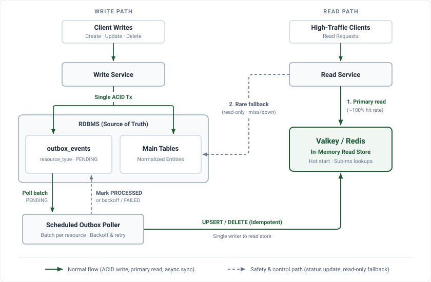

In many backend systems, Valkey or Redis is used as a reactive cache in front of a relational database (RDBMS). When a key is missing or expired, the application reads from SQL, saves the result back to memory, and returns the response.

This works well for general workloads. However, for very read-heavy systems that need fast and predictable response time, waiting for cache misses becomes a bottleneck.

A practical alternative is **proactive caching with a pessimistic fallback**: pushing every write into memory ahead of time using the Outbox pattern—aiming for close to a 100% hit rate—while keeping the RDBMS as a rare, read-only fallback.

Structurally, this approach sits between caching and lightweight CQRS. The write and sync path behaves like CQRS—projecting normalized relational tables into a separate read model—while the read-only fallback keeps the safety of a traditional cache.

## Reactive Cache-Aside vs. Proactive Caching

The main difference between the two models is **cold start vs. hot start** behavior and how data reaches memory:

| Aspect | Reactive Cache-Aside | Proactive Caching (+ Fallback) |
| :--- | :--- | :--- |
| **How data enters memory** | Loaded only after a read miss. | Pushed ahead of time via Outbox. |
| **Cold start vs. hot start** | **Cold start.** Restarts or expired TTL cause slow misses until traffic warms the cache. | **Hot start (once seeded).** Data is already in memory before read requests arrive, so app deployments stay hot. |
| **Expected hit rate** | 80% – 95% (misses are normal). | ~100% (misses are rare signals). |
| **If memory store is down** | Heavy fallback hits the RDBMS. | Read-only fallback keeps reads working. |

Under reactive caching, cache misses are part of normal traffic. Under proactive caching, the in-memory store stays hot as the main read database, and any fallback read to the RDBMS is treated as an unusual signal.

## Architecture Overview

To keep both databases in sync without waiting on memory availability during writes, the design uses the **Transactional Outbox Pattern** with the RDBMS as the single commit point.

The flow has three main parts:

### 1. Transactional Write Path
Instead of creating events for every database table, each outbox row represents an API resource (`resource_type`). One client write—create, update, or delete—often updates several related tables, while the read store needs one combined data payload.

Inside a single ACID transaction, the Write Service updates the main tables and inserts one row into `outbox_events` with:

- **Event details:** `event_id`, `operation` (`UPSERT` or `DELETE`), and `event_timestamp` (for lag monitoring).
- **Resource data:** `resource_type`, `resource_id`, and `payload` (stored as plain text).
- **Delivery fields:** `status` (`PENDING`, `PROCESSED`, or `FAILED`), `retry_count`, and `next_retry_at` for backoff.

If the transaction commits, both data and event are saved safely. If anything fails, both roll back together.

### 2. Scheduled Outbox Poller
A background worker polls `PENDING` rows in configurable batches per `resource_type` and updates the in-memory store.

In multi-instance deployments, a lightweight lock per `resource_type` (such as a database advisory lock or distributed scheduler lock) ensures only one worker processes a given resource at a time. Different resource types still run in parallel across instances, while each resource keeps strict event order. Configurable batch limits keep transactions short, and `next_retry_at` prevents fast retry loops during brief outages.

### 3. Read-Only Pessimistic Fallback
On the read path, every request checks the in-memory store first. The RDBMS is only queried when a key is missing or the memory store is down.

This fallback is **strictly read-only**: it returns the data directly without writing back to memory. Keeping the Outbox poller as the only writer avoids a race condition where a slow fallback read overwrites newer data with an older value.

## Comparing Sync Options

There are three common ways to keep an RDBMS and an in-memory store in sync: direct dual writes, log-based CDC, or a scheduled Outbox poller.

### 1. Why Not Direct Dual Writes?
Writing to both the RDBMS and the in-memory store inside one request looks simple, but data mismatch happens easily:

- **RDBMS succeeds, memory store fails:** Live traffic keeps reading old data from memory.
- **Memory store succeeds, RDBMS rolls back:** Live traffic reads data that was never saved.
- **Concurrent writes finish out of order:** Two updates can finish in different orders in each store.

Because both stores do not share one transaction, direct dual writes always carry a risk of silent data drift.

### 2. Why Polling Instead of CDC?
Log-based Change Data Capture (CDC), such as Debezium, works well for large streaming pipelines, but on an RDBMS it introduces a major operational risk: **transaction log retention and disk growth**.

CDC reads from database transaction logs (such as WAL in PostgreSQL, transaction or archive logs in SQL Server and Oracle, or binary logs in MySQL). If the CDC consumer stays down for too long, the database faces a hard trade-off: either keep holding cluster-wide logs until the primary disk fills up, or expire and invalidate the log position (such as hitting `max_slot_wal_keep_size` in PostgreSQL or binlog expiry in MySQL). Once that happens, the sync pipeline breaks and usually requires manual recovery or a full re-snapshot.

With a scheduled poller, the impact stays contained. If the worker goes down, the RDBMS keeps running normally, pending events wait in one table, and syncing resumes automatically once the worker comes back. Polling still needs regular cleanup and table maintenance (such as autovacuum in PostgreSQL) to prevent table bloat, but it avoids unbounded log growth across the whole database.

| Sync Approach | Consistency Risk | Risk to RDBMS Disk | Operational Complexity |
| :--- | :--- | :--- | :--- |
| **Direct Dual Writes** | High (data drift) | Low | Low |
| **Outbox + CDC** | Low (transactional) | High (log growth / broken offset) | High |
| **Outbox + Poller** | Low (transactional) | Manageable (table bloat if cleanup lags) | Low |

## 4 Important Things for Production

1. **Idempotent writes:** If a worker crashes before marking a batch `PROCESSED`, the events will run again. Sending full `UPSERT` and `DELETE` payloads guarantees the same final state on replay.
2. **Scaling order safely if parallel workers are needed:** Locking per `resource_type` is enough for most read-heavy workloads. If one resource type ever needs parallel workers using row-skipping locks (such as `FOR UPDATE SKIP LOCKED` or `READPAST`), a newer batch can finish before an older batch for the same key. In that case, checking a monotonic **entity version** (incremented on each database update)—rather than wall-clock timestamps—prevents older updates from overwriting newer data in memory.
3. **Handling empty restarts, deleted keys, and invalid lookups:** Running the memory store with persistence and replicas, and keeping a warm-up sync job ready for fresh nodes, protects against empty restarts. Both invalid IDs and recently deleted records also look like cache misses on the read path. Input validation and bounded fallback limits protect the RDBMS from invalid lookups, while letting the Outbox poller write short-TTL tombstone markers on `DELETE` blocks repeated misses without breaking the single-writer rule.
4. **Monitoring and avoiding table bloat:** Key signals to monitor include sudden jumps in RDBMS fallback reads, `PENDING` queue size, oldest pending event age (via `event_timestamp`), and `FAILED` rows. Cleaning up old `PROCESSED` rows regularly—or deleting rows directly after syncing—keeps the outbox table and its indexes compact.

## When This Pattern Fits

This pattern works well when reads are much higher than writes, the active dataset fits in memory, and a short sync delay (milliseconds to a few seconds) is acceptable.

It is not a good fit when the dataset is much larger than available RAM, when write traffic is very high, or when reads require strict immediate consistency right after a write.

## Final Thoughts

Proactive caching with the Outbox pattern lets each database do what it does best. The RDBMS handles safe transactions and acts as a read-only fallback, while the in-memory store stays hot for fast reads.

Complex streaming tools are not always needed to connect them. A simple resource-level outbox table, a scheduled poller as the single writer, and a read-only fallback are often enough to keep a system fast and easy to operate.